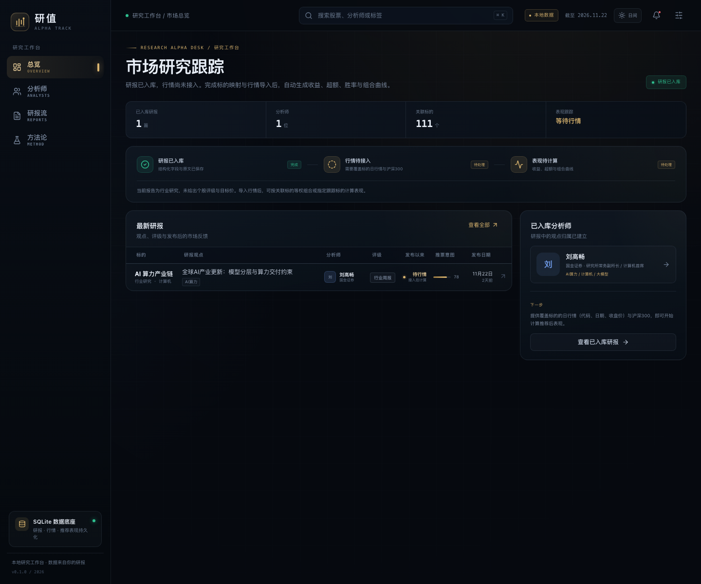
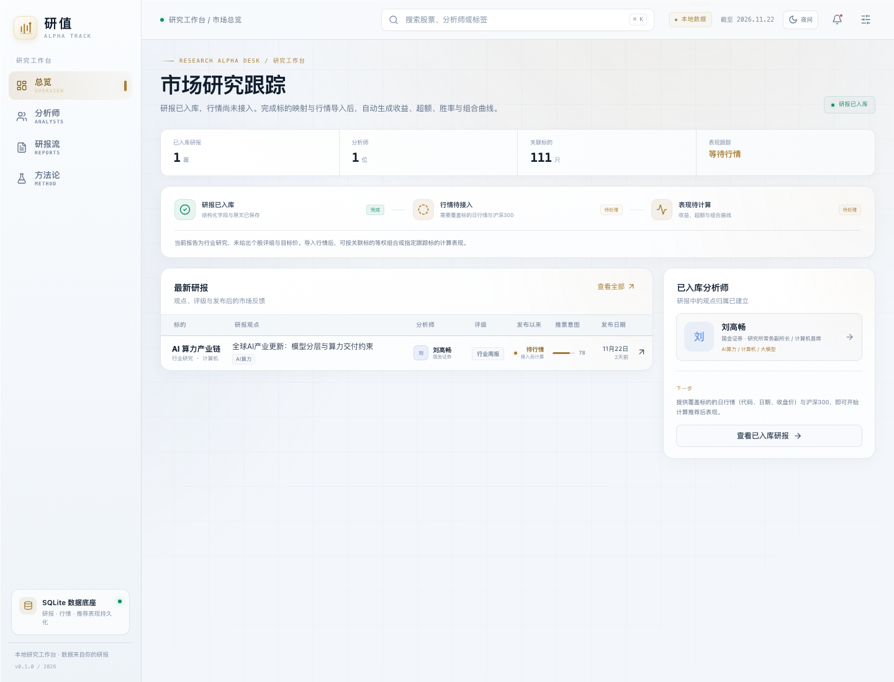

# 研值 · 分析师 Alpha 跟踪台

> 跟踪分析师观点，验证研报发布后的真实超额。

一个本地研究工作台：**FastAPI + SQLite** 提供数据与指标服务，**React + Vite + Recharts** 提供金融终端风格的展示。覆盖「市场总览 → 分析师专题 → 研报流 → 单篇研报拆解」的完整链路。

## 当前状态：第一份研报已入库，等待行情

**模拟数据已全部清空；第一份真实研报已结构化入库。**

| 数据表 | 当前行数 |
| --- | --- |
| `analysts` | 1 |
| `reports` | 1 |
| `prices` | 0 |
| `indices` | 0 |

- 分析师：**刘高畅**，国金证券研究所常务副所长 / 计算机首席；
- 研报：**《全球AI产业更新：模型分层与算力交付约束》**，2026-11-22，行业周报；
- 来源：[微信公众号 · 计算机畅想](https://mp.weixin.qq.com/s/5Bsys6SL71VCmtMg0i7oaw)；
- 当前 `has_performance = false`，总览显示“研报已入库 / 行情待接入”，不展示伪造的收益曲线；
- 行业周报未给出个股评级与目标价，相关标的仅为原文列示线索，不构成个股推荐。



### 这篇报告的核心结论

- 11 月头部模型更新从单一旗舰转向**能力、速度与价格分层**，企业部署开始采用多模型路由。
- 算力需求仍强，但约束从芯片产能延伸到**整柜交付、电力并网与项目融资**。
- BIS 将先进芯片管制延伸至海外数据中心远程算力，**合规能力**开始影响客户结构与数据中心融资。
- 得州恢复环境许可审查、欧洲拟以公共资本提升算力份额，但电网、许可与社区接受度仍是瓶颈。
- 报告梳理了国内算力、海外算力、大模型&云、AI 应用四条相关标的线索，共 111 个名称（原文列示，不构成推荐）。

完整结构化字段、原文（约 10,000 字）、关联标的与来源链接已写入 `reports` / `analysts`。

### 还缺什么

当前没有行情数据，因此以下指标**暂不计算**：

- 个股 / 组合收益与相对沪深300超额；
- 推荐胜率、最大浮盈、持有天数；
- 分析师 Alpha 分与推荐组合曲线。

需要补充：

1. 覆盖标的的日行情：`股票代码、日期、收盘价`；
2. 沪深300等基准指数日行情；
3. 明确这篇行业研报要跟踪的标的池（可使用原文关联标的，或指定一个子集）。

### 如何继续导入

把研报文件放到 [imports/](imports/README.md)，或直接提供文件路径 / 下载链接。结构化的研报可以走现有导入器：

```bash
python3 -m backend.importer imports/liu-gaochang-2026-11-22.json
```

当前版本已具备“结构化研报入库 → 研报流 → 详情抽屉 → 原文回看”的链路，**尚未接入 PDF/Excel 自动解析器**。

## 数据齐备后可以看到什么

- **市场总览**：主要指数快照、市场温度、5 个核心 KPI、等权推荐组合 vs 沪深300、推票意图分布、月度超额、行业超额、最新研报、分析师 Alpha 榜。
- **分析师专题**：分析师画像、Alpha 分、胜率/平均超额/最佳单笔/平均持有、推荐组合曲线、五维风格雷达、行业与评级偏好、全部研报明细。
- **研报流**：关键词搜索、评级筛选、按发布时间/超额/意图强度排序。
- **研报详情抽屉**：价格路径（发布日=100）、入场/最新/目标价、目标进度、推票意图拆解、核心逻辑、关联标的、风险提示与原文。
- **可导出**：总览页一键导出 CSV 跟踪表。
- **日间 / 夜间双主题**：一键切换，偏好写入 `localStorage`，图表、卡片与详情抽屉同步换色。
- **响应式**：桌面侧边栏 + 移动端底部导航，390px 宽度无横向溢出。

## 快速启动

环境：Python 3.11+、Node.js 20+、pnpm。

```bash
./run.sh
# 打开 http://127.0.0.1:8787
```

自定义端口：

```bash
PORT=9000 ./run.sh
```

当前数据库已有 1 篇研报。服务启动只做建表，**不会自动写入模拟数据**。数据库文件在 `data/tracker.db`。

### 前端开发模式

终端 1：

```bash
python3 -m uvicorn backend.main:app --host 127.0.0.1 --port 8787 --reload
```

终端 2：

```bash
pnpm --dir frontend dev
# 打开 http://127.0.0.1:5173，Vite 已代理 /api 到 8787
```

## 清空 / 恢复演示数据

随时清空当前数据，保留表结构：

```bash
python3 -m backend.clear_data
```

代码中保留了早期的虚拟演示数据，用于界面回归测试，但默认不会加载。只有显式执行以下命令才会写入：

```bash
python3 -m backend.seed --demo
```

> 警告：`--demo` 会重新写入 6 位虚构分析师、21 篇虚构研报和模拟行情，请勿与真实跟踪数据混用。当前已入库的研报会被覆盖，请先备份 `data/tracker.db`。

## 指标口径

| 指标 | 计算方式 |
| --- | --- |
| 推荐收益 | `最新收盘价 / 研报发布日收盘价 - 1` |
| 超额收益 | 推荐收益 − 同期沪深300收益 |
| 推荐胜率 | 超额收益 > 0 的研报数 / 纳入统计研报数 |
| 平均最大浮盈 | 发布后至最新交易日，区间最高收盘价 / 入场价 − 1 |
| 组合曲线 | 按发布日入场，对所有仍在跟踪的推荐做等权平均，起点归零 |
| 市场温度 | 沪深300 20 日动量 + 覆盖标的站上 20 日线比例 + 均线状态，归一化到 0–100 |
| 推票意图分 | 评级强度 32 + 目标空间 30 + 催化明确度 20 + 观点一致性 18 |
| Alpha 分 | `50 + (胜率 − 50) × 0.40 + 平均超额 × 2.2`，限制在 40–96 |

推票意图当前是**可解释的规则评分**，不是黑盒模型。它把「强看多」拆成评级、目标价空间、催化剂、观点一致性四个可审计维度；后续处理研报原文时，可以在入库阶段加一层 LLM/规则混合结构化。

## 为什么这个需求需要数据库？

**结论：需要，但当前阶段不需要重型数据库。SQLite 是合适的起点。**

这个产品不是一次性报表，而是持续跟踪：

- 研报会不断新增、修订评级、调整目标价；
- 行情每个交易日更新，推荐表现需要按发布时间回算；
- 需要按分析师、行业、评级、月份多维聚合；
- 同一篇研报在不同时点的表现要能复现，不能每次打开页面都临时拼 Excel。

这些需求天然适合关系型数据库：研报、分析师、行情、指数是不同实体，靠 `stock_code` 和 `date` 对齐，用 SQL 聚合最直接。若用 JSON/Excel，随着研报数量增加，口径、去重和回算会很快失控。

当前表结构：

```text
analysts 1 ─── N reports
reports.stock_code + publish_date ─── prices.stock_code + date
indices（沪深300 / 上证 / 深证 / 创业板）
```

推荐表现和指标没有落成固定表，而是由 [backend/analytics.py](backend/analytics.py) 基于 `reports + prices + indices` 实时计算。这样做的好处是口径集中、改公式无需回填；坏处是每次请求都要重算。

### 什么时候升级

出现以下任一情况，就应从 SQLite 迁移：

1. 真实行情进入日频/分钟级，数据量到千万行以上；
2. 多用户并发、需要权限与审计；
3. 需要保存「每日推荐表现快照」以保证历史可复现；
4. 接入 PDF 原文、OCR、LLM 结构化，需要对象存储与任务队列；
5. 需要实时行情推送或多市场、多币种。

推荐演进路径：

- **PostgreSQL**：分析师、研报、评级变动、用户自选等事务数据；
- **TimescaleDB / ClickHouse**：行情与推荐日快照等时序数据；
- **对象存储**：PDF 原文、解析段落、附件；
- **Redis + 任务队列**：收盘后增量计算、缓存、提醒；
- **LLM 结构化管线**：从研报原文抽取观点、目标价、催化剂、风险。

一句话：**先用 SQLite 把数据模型和指标口径跑通，再根据真实数据量升级。**

## 技术结构

```text
backend/
  main.py          FastAPI 路由 + 静态站点托管
  db.py            SQLite 连接、建表、空库初始化
  analytics.py     推荐表现、市场温度、意图评分、聚合接口
  clear_data.py    清空数据但保留表结构
  seed.py          可选演示数据（默认不加载，需 --demo）
frontend/
  src/pages/       总览 / 分析师 / 分析师详情 / 研报流 / 方法论
  src/components/  图表、研报表格、分析师榜、详情抽屉、空态组件
  src/styles.css   金融终端主题、日夜双主题与响应式布局
imports/           待导入研报文件目录
data/tracker.db    SQLite（当前为空库）
docs/screenshots/  界面参考截图
```

后端接口：

| 方法 | 路径 | 说明 |
| --- | --- | --- |
| GET | `/api/overview` | 总览聚合；通过 `has_data` / `has_performance` 区分空库、待行情、可计算 |
| GET | `/api/analysts` | 分析师榜单 |
| GET | `/api/analysts/{id}` | 分析师专题 |
| GET | `/api/reports?rating=&q=&analyst=` | 研报流 |
| GET | `/api/reports/{id}` | 单篇研报 + 价格路径 + 意图拆解 |
| GET | `/api/meta` | 数据日期、数量与导入状态 |
| GET | `/docs` | FastAPI 自动接口文档 |

## 界面参考

当前数据（1 篇研报、行情待接入）：

| 夜间模式 | 日间模式 |
| --- | --- |
|  |  |

更多：[研报流](docs/screenshots/report-feed-liu.png)、[分析师专题](docs/screenshots/report-analyst-liu.png)、[研报详情](docs/screenshots/report-drawer-liu.png)。

早期演示数据下的完整图表界面：[夜间总览](docs/screenshots/overview.png)、[日间总览](docs/screenshots/light-overview.png)、[研报详情](docs/screenshots/report-drawer.png)、[移动端](docs/screenshots/mobile.png)。

## 下一阶段

1. **研报自动解析**：PDF / Word / Excel → 分析师、评级、目标价、观点、风险；当前已完成第一份结构化手工入库。
2. **行情接入**：个股日行情 + 沪深300，统一入场与复权口径，并明确行业研报的跟踪标的池。
3. **推荐日快照**：每天收盘后固化推荐表现，避免历史页面随最新价格漂移。
4. **观点修正追踪**：同一分析师对同一标的的评级/目标价变化时间线。
5. **真实数据校验**：研报版权授权、行情源校验、发布时间时区与停牌处理。

## 数据边界

当前已入库 1 篇公开研报，行情尚未接入，页面不会生成任何虚构的收益或排名。接入更多真实数据前，应补充研报版权授权、行情源校验、发布时间时区与停牌处理。手动运行 `--demo` 写入的是仅供界面演示的虚构数据，请勿与真实跟踪混用；任何指标都不构成投资建议。
